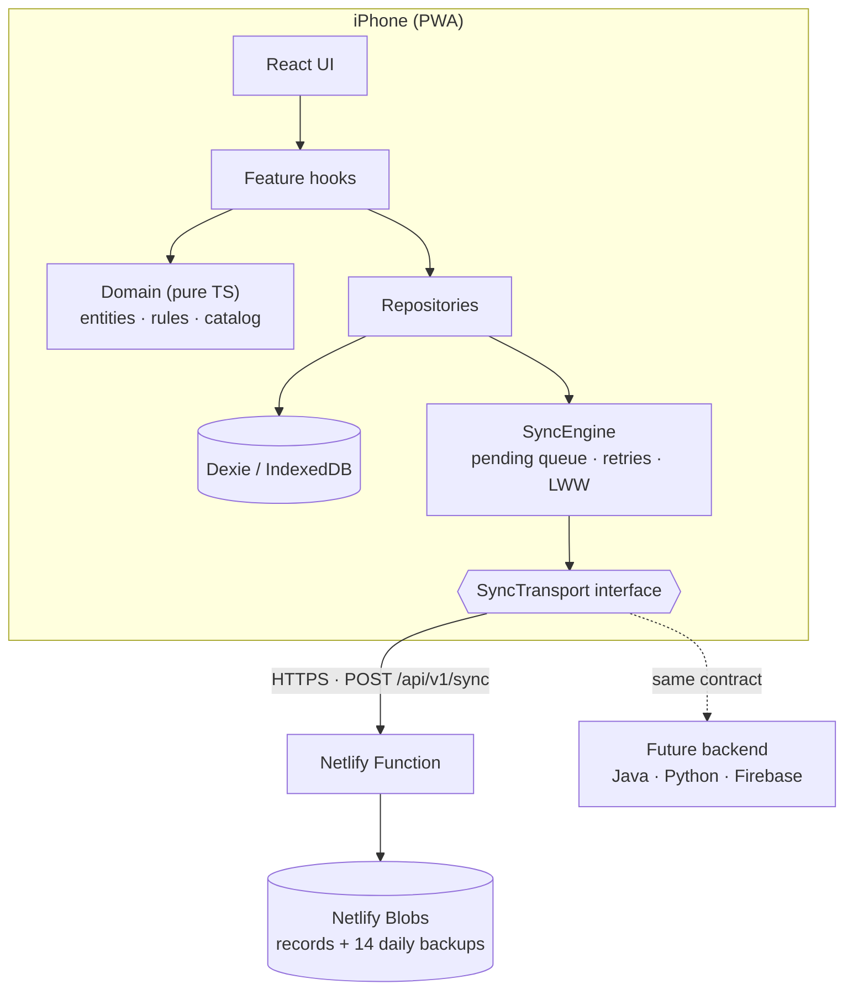

# Certavi

**An offline-first PWA for logging strength training — built to work in a gym basement with no signal, and to never lose a set.**

Certavi tracks routines, workout sessions and sets (weight, reps, RIR), weekly volume per muscle
group, personal records, body weight and optional mobility / rehab blocks. It installs on an
iPhone from Safari and runs entirely on the device; a tiny backend only syncs and backs up data.

> **Status:** early development — Phase 0 (project foundation). See the [roadmap](#roadmap).

---

## Screenshots

| Today               | Active session      | Progress            |
| ------------------- | ------------------- | ------------------- |
| _coming in Phase 5_ | _coming in Phase 5_ | _coming in Phase 7_ |

---

## Features

**Planned for v1.0.0** (parity with the previous app plus improvements):

- **Today** — suggested session for the weekday, free sessions, logging on another date,
  hiking and deload weeks, activities, weekly body weight, today's optional blocks.
- **Active session** — last time's numbers as reference, warm-up sets with their own symbol
  (excluded from stats), extra and back-off sets, straps and band flags, notes, readiness (1–5),
  rest timer with sound and vibration, reorder / add / remove exercises **and sets**.
- **Exercise catalog** — filters by text, muscle group, equipment, type, straps, custom and
  "in a routine"; equipment tag on every exercise; create exercises from scratch.
- **Routines** — editor with set schemes (approach / top / back-off / straight / Bilbo) and RIR.
- **Progress** — effective sets per muscle group vs plan, records, estimated 1RM, body weight,
  cycle review — all with hand-written, accessible SVG charts.
- **Optional blocks** — configurable mobility, stretching and rehab checklists with 0–10 metrics.
- **Offline-first sync** across devices, daily server backups, JSON / CSV export and import.
- **Light / dark / automatic theme**, **Spanish and English**.

---

## Tech stack

| Area       | Choice                                                                 |
| ---------- | ---------------------------------------------------------------------- |
| Language   | TypeScript (strict)                                                    |
| UI         | React 19 · Vite · CSS Modules + design tokens                          |
| Local data | IndexedDB via Dexie (source of truth)                                  |
| Validation | zod (shared client / server contract)                                  |
| i18n       | i18next (es / en)                                                      |
| PWA        | vite-plugin-pwa (Workbox)                                              |
| Backend    | Netlify Functions (TypeScript) + Netlify Blobs                         |
| Testing    | Vitest · React Testing Library · Playwright (Chromium + WebKit)        |
| Quality    | ESLint (type-checked) · Prettier · husky + commitlint · GitHub Actions |

---

## Architecture



- **Domain** (`src/domain`) is pure TypeScript — no React, no database — and fully unit-tested.
- **The backend is deliberately dumb**: it stores records, applies last-write-wins and keeps
  daily backups. All business logic runs on the client, so the app works fully offline.
- **Swappable backend**: the client only talks to a `SyncTransport` interface. Any server that
  implements the [sync v1 contract](docs/api/sync-v1.md) can replace Netlify.
- Decisions are recorded as ADRs in [`docs/adr/`](docs/adr/).

### Offline-first and sync

1. Every write lands in IndexedDB first and is added to a **pending queue in the same
   transaction** — a saved set is never left unqueued.
2. A sync engine pushes pending records and pulls changes since the last known `serverSeq`.
3. Conflicts resolve with **last-write-wins** on `updatedAt`; deletions are soft
   (`deleted: true`) so they propagate to every device.
4. Failed syncs retry with backoff (4 → 60 s); syncing also runs when the app regains focus or
   connectivity, and a `keepalive` request flushes pending data when the phone is locked.
5. The server keeps a **daily backup** (Europe/Madrid time) and the 14 most recent ones, which
   can be listed, downloaded and restored from Settings.

See [ADR-0002](docs/adr/0002-offline-first-lww-sync.md) for the reasoning.

---

## Project structure

```
src/
  app/        routes, layout, providers
  domain/     entities, zod schemas, rules, seed data (pure TS)
  data/       Dexie, repositories, sync engine, transports, import/export
  features/   today, session, calendar, routines, exercises, progress, blocks, settings
  ui/         shared components (Button, Dialog, Sheet, NumberField…)
  i18n/       es.json, en.json
  theme/      tokens, themes, fonts
netlify/functions/   sync endpoint
tests/e2e/           Playwright specs
docs/                spec, API contract, ADRs, design, migration
```

---

## Getting started

### Requirements

- **Node.js ≥ 22.22.2** (see `.nvmrc`)
- npm 10+
- Git (on Windows, `core.autocrlf false` is recommended; `.gitattributes` enforces LF anyway)

### Install

```bash
git clone https://github.com/<your-user>/certavi.git
cd certavi
npm ci
npx playwright install chromium webkit   # browsers for end-to-end tests
```

`npm ci` also installs the git hooks (husky).

### Scripts

| Script                            | Description                                                        |
| --------------------------------- | ------------------------------------------------------------------ |
| `npm run dev`                     | Start the dev server on http://localhost:5173                      |
| `npm run build`                   | Type-check and build for production into `dist/`                   |
| `npm run preview`                 | Serve the production build on http://localhost:4173                |
| `npm run lint`                    | ESLint                                                             |
| `npm run typecheck`               | TypeScript project build check                                     |
| `npm run test`                    | Unit and component tests (single run)                              |
| `npm run test:watch`              | Tests in watch mode                                                |
| `npm run e2e`                     | End-to-end tests (builds, serves and stops the app by itself)      |
| `npm run format` / `format:check` | Prettier                                                           |
| `npm run ports:check`             | Show which dev ports (5173, 4173, 8888, 8787) are busy and by what |
| `npm run ports:kill`              | Free those ports                                                   |

---

## Testing

- **Unit and component tests** live next to the code (`*.test.ts(x)`) and run with Vitest,
  React Testing Library and jsdom.
- **End-to-end tests** in `tests/e2e/` run with Playwright on Chromium and WebKit at an iPhone
  viewport (390×844). Chromium runs every test; WebKit (Safari's engine) runs the ones tagged
  `@all-engines` — local data, sync, import / export, Today and the 390 px layout. They are written black-box from the functional spec in
  [`docs/spec/`](docs/spec/README.md), without looking at the source.
- Tests use synthetic data only.

```bash
npm run test
npm run e2e
```

CI runs lint, typecheck, tests and build on every pull request to `dev` and `main`.

---

## Deployment (Netlify)

Deployment is set up in Phase 4, when the sync backend exists:

1. Netlify → **Add new project** → import this repository.
2. **Production branch:** `main`. **Branch deploys:** `dev` only. **Deploy previews:** off.
3. Build command `npm run build`, publish directory `dist`, functions in `netlify/functions`.
4. Add the environment variables below.

### Environment variables

| Name         | Where                                     | Description                                                                                        |
| ------------ | ----------------------------------------- | -------------------------------------------------------------------------------------------------- |
| `CLAVE_SYNC` | Netlify site settings (never in the repo) | Shared secret for the sync API. Random, at least 32 characters. Devices send it as a Bearer token. |

`.env*` files are git-ignored. Never commit a real value.

---

## Contributing workflow

- **Branches:** `main` (production) · `dev` (integration) · `feature/*`, `fix/*`, `chore/*`,
  `docs/*` from `dev`, merged back into `dev` through pull requests (merge commits, no squash).
- **Commits:** [Conventional Commits](https://www.conventionalcommits.org/), e.g.
  `feat(session): allow removing planned sets`. Enforced by commitlint on every commit.
- **Releases:** PR `dev → main`, version bump in `package.json`
  (`chore(release): vX.Y.Z`) and an annotated tag `vX.Y.Z`.
  Changes are recorded in [`CHANGELOG.md`](CHANGELOG.md) (Keep a Changelog, SemVer).

---

## Roadmap

| Version    | Milestone                                                |
| ---------- | -------------------------------------------------------- |
| v0.1.0     | Project foundation: tooling, CI, docs, Claude Code setup |
| v0.2.0     | Design system, theme, i18n and navigation shell          |
| v0.3.0     | Domain model and exercise catalog                        |
| v0.4.0     | Local database, legacy importer and exports              |
| v0.5.0     | Sync engine and backend                                  |
| v0.6.0     | Today screen and active session                          |
| v0.7.0     | Catalog filters, custom exercises and routine editor     |
| v0.8.0     | Calendar, progress, exercise details and optional blocks |
| v0.9.0     | PWA polish, accessibility and performance                |
| **v1.0.0** | Full QA, real data migration and production release      |

Later: machine photos, a "real" backend if ever needed, cycle templates and comparisons,
supersets.

---

## License

Copyright © 2026 Armando Vaquero Vargas. **All rights reserved** — see [LICENSE](LICENSE).
The project will be released under the MIT License when the repository becomes public.
